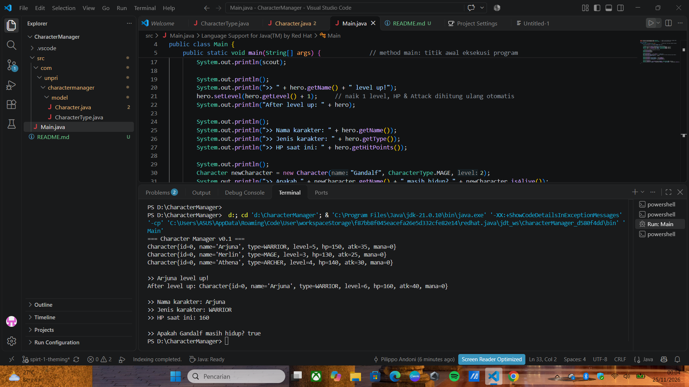
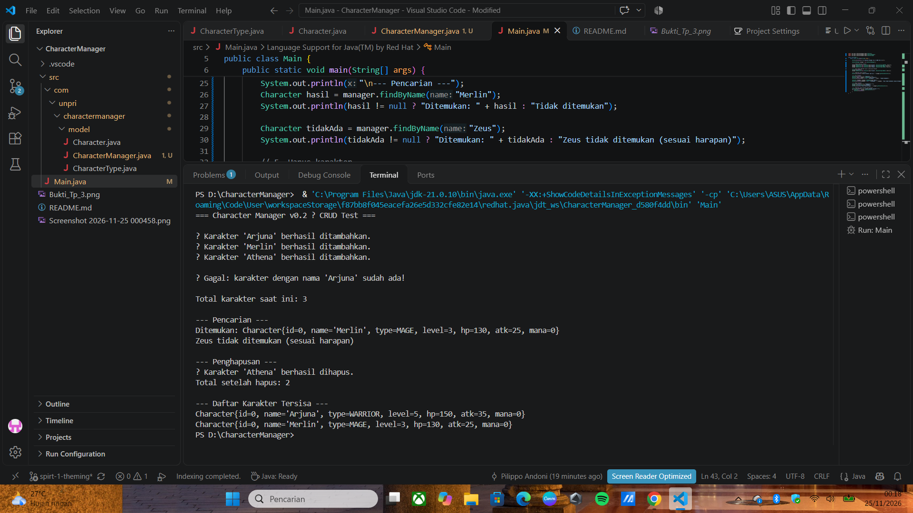
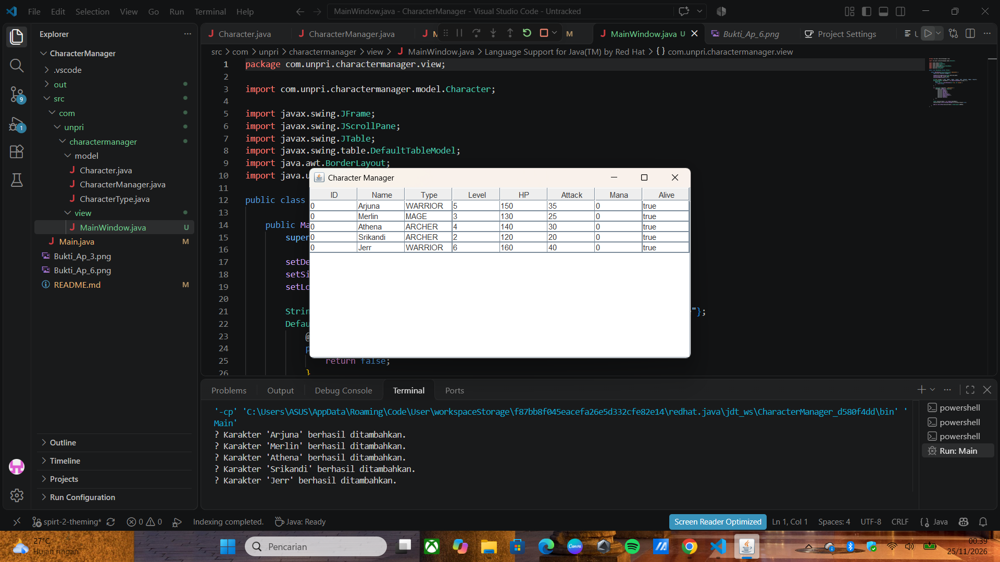
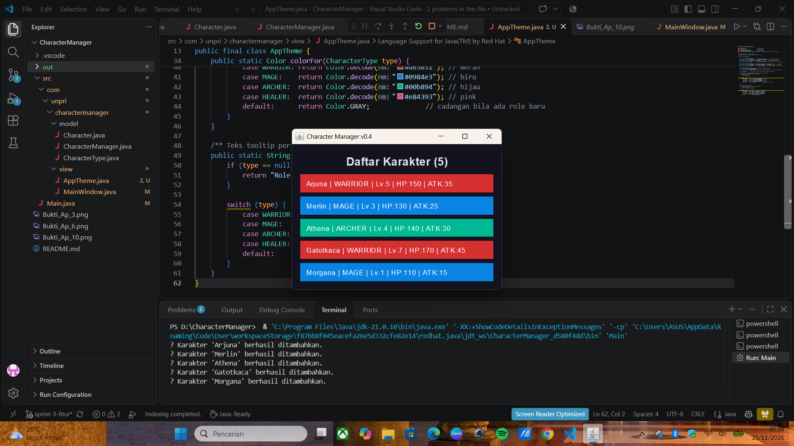
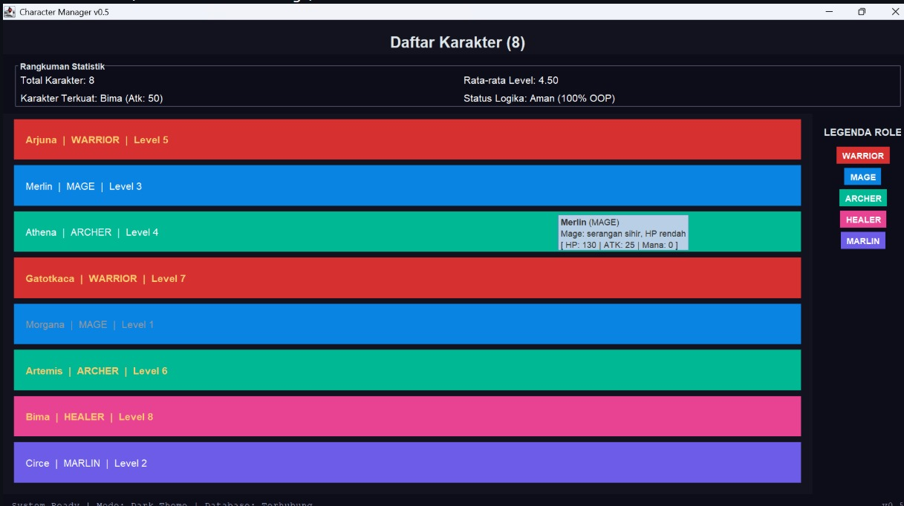
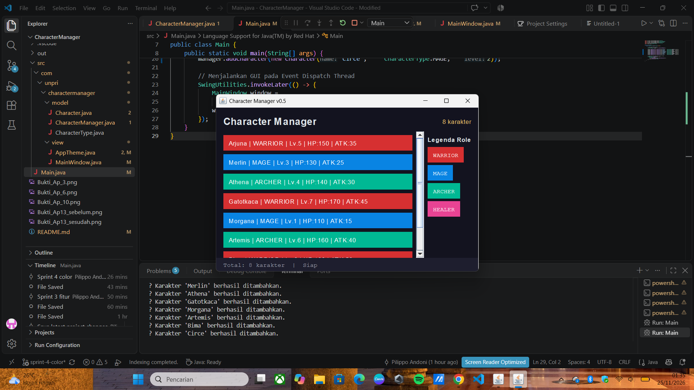

### AP3 - Character Manager (Java Visual SIH-6406)
Aplikasi ini adalah sistem manajemen karakter sederhana berbasis teks (Console-based Game Character Manager) yang dibangun menggunakan bahasa pemrograman Java. Proyek ini menerapkan prinsip Pemrograman Berorientasi Objek (OOP), khususnya enkapsulasi (Encapsulation) dengan pembatasan hak akses atribut menggunakan setter, getter, serta fungsi validasi nilai logika. Sistem juga mendukung kalkulasi otomatis status karakter (HP dan Attack) berdasarkan level serta fitur pelacakan kondisi hidup/mati karakter.

## Screenshot Output Terminal ap3

Struktur Folder Project

Screenshot ini mendokumentasikan demo sebelumnya yang menampilkan hasil isAlive(). Main.java sekarang menjalankan demo CRUD v0.2.

### Struktur Project
CharacterMaager_/
├── src/
│   ├── Main.java
│   └── com/
│       └── unpri/
│           └── charactermanager/
│               │── model/
│               │   ├── Character.java
│               │   ├── CharacterType.java
│               │   └── CharacterManager.java
│               └── view/
│                   ├── AppThema.java
│                   ├── CharacterFormPanel.java 
│                   └── MainWindow.java 
│              
├── Bukti_Ap_3.png
│── Bukti_Ap_6.png
├── Bukti_Ap_10.png
├── Bukti_Ap_13_sebelum.png
├── Bukti_Ap_13_sebelum.png
├── UkuranAwal.png
├── maximized.png.jpeg
├── Minimized.png
├── sebelum.png
├── sesudah.png
└── README.md

### AP6 - Fitur Baru: Pencarian Karakter Terkuat (findStrongest)
Rasional / Alasan Fitur Dalam pengembangan sebuah game atau sistem RPG, mengetahui entitas atau karakter mana yang memiliki statistik tertinggi (terkuat) merupakan fitur analisis data yang sangat krusial. Fitur findStrongest() ditambahkan untuk mempermudah sistem dalam menyaring karakter dengan daya serang (attackPower) paling mendominasi tanpa mengharuskan layer aplikasi melakukan pengurutan (sorting) manual di sisi luar.

Menjaga Prinsip OOP & Enkapsulasi Defensive Design: Method mengembalikan satu objek Character tunggal atau nilai null apabila sistem belum memiliki data karakter sama sekali. No Information Leakage: Struktur data internal ArrayList characterList milik CharacterManager tetap terkunci rapat di dalam class (private). Akses luar murni hanya mendapatkan hasil kalkulasi/pencarian objek spesifik tanpa diberi celah untuk memodifikasi atau menambah isi list secara ilegal.

## screenshot Output Terminal Ap6

### AP10 — Character Manager GUI dan Statistik Karakter
Aliran Data dan Penerapan MVC Aliran data aplikasi dimulai dari Main.java, yang membuat objek Character dan menambahkan data karakter ke CharacterManager. Main.java mengirimkan objek CharacterManager langsung ke MainWindow agar daftar yang ditampilkan selalu mengambil data terbaru dari Model. CharacterFormPanel menambahkan karakter melalui manager dan memanggil refreshList() pada MainWindow untuk memperbarui kartu, jumlah karakter, serta status. Dalam konsep MVC, package model bertanggung jawab terhadap data dan logika karakter, sedangkan MainWindow dan CharacterFormPanel berperan sebagai bagian View.

Karakter Baru dan Alasan Pemilihan Tipe/Level Dua karakter baru ditambahkan untuk memenuhi kebutuhan minimal lima karakter sekaligus memberikan variasi tipe dan level pada aplikasi. Srikandi — ARCHER, Level 2: Dipilih sebagai karakter pemanah dengan level awal yang relatif rendah untuk menunjukkan variasi statistik pada karakter yang masih berkembang. Bima — WARRIOR, Level 6: Dipilih sebagai karakter petarung dengan level lebih tinggi untuk memberikan perbandingan statistik dengan karakter berlevel rendah serta membantu menguji perhitungan rata-rata level. Penambahan karakter dengan tipe dan level yang berbeda memungkinkan aplikasi menampilkan data yang lebih bervariasi dan menguji apakah statistik rata-rata level dihitung berdasarkan seluruh karakter secara akurat.

## Screenshot Output Terminal ap10 

### AP13 — Dokumentasi Pembaruan GUI & Manajemen Tema
## 1. Rasionalisasi Pemisahan Data Warna (AppTheme vs Character)
Penyimpanan data warna dikelola secara terpusat di dalam kelas AppTheme (atau AppThema) dan bukan di dalam kelas Character demi menjaga prinsip Separation of Concerns (Pemisahan Tanggung Jawab) pada arsitektur MVC. Kelas Character murni bertindak sebagai Model yang hanya bertanggung jawab atas logika data dan status internal karakter seperti nama, level, atau poin kesehatan. Jika warna dimasukkan ke dalam kelas Character, hal tersebut akan merusak enkapsulasi karena memaksa komponen Model untuk memahami elemen visual grafis yang merupakan ranah penuh dari komponen View. Dengan pendekatan ini, perubahan tema visual seluruh aplikasi di masa mendatang dapat dilakukan dengan cepat hanya melalui satu file konfigurasi saja tanpa berisiko merusak logika bisnis inti.

## 2. Daftar Properti Tambahan Visual dan Alasan Pemilihan
Untuk meningkatkan kualitas antarmuka dan pengalaman pengguna (UX), berikut adalah dua properti tambahan yang disematkan ke dalam kartu komponen GUI:

Restriksi Akses Karakter Pemula (setEnabled(false))
Alasan: Properti ini dipilih untuk memberikan indikasi visual yang kuat terhadap status kesiapan karakter. Karakter berlevel 1 dianggap sebagai entitas pemula (trainee) yang belum memiliki kapabilitas bertarung, sehingga komponen visualnya sengaja dinonaktifkan untuk menyimulasikan pembatasan akses interaksi dalam sistem permainan.
Mekanisme Informasi Melayang (Dynamic HTML Tooltip)
Alasan: Properti ini diimplementasikan untuk mempertahankan estetika jendela aplikasi agar tetap bersih, minimalis, dan ringkas. Rincian status sekunder yang padat seperti daya tahan (hitPoints) dan daya serang (attackPower) dipindahkan ke dalam hover tooltip berformat HTML sehingga pengguna tetap dapat meninjau statistik mendalam tanpa membuat tata letak utama menjadi penuh sesak.
## Screenshot Output (sebelum vs sesudah)
# Sesudah

# Sebelum

### AP16 — Dokumentasi Pembaruan GUI, Manajemen Tema & Pengembangan Antarmuka Grafis Terstruktur (v0.5)
Analisis Pemilihan Layout Antarmuka (v0.5)
## 1. Mengapa GridLayout (2x2) Dipilih untuk Panel Statistik?
Alasan Desain: Panel statistik menyajikan 4 metrik ringkas informasi metadata aplikasi. GridLayout(2, 2) dipilih karena memaksa setiap grid component memiliki ukuran kotak yang seragam secara simetris, menghasilkan visual baris-kolom yang sangat rapi untuk widget data ringkas. Ketika aplikasi dilebarkan secara horizontal, grid akan meregang merata mengikuti dinamika ukuran jendela tanpa merusak struktur baris.
## 2. Mengapa Absolute Layout (setLayout(null)) Ditolak Keras?
Alasan Penolakan: Absolute Layout mengharuskan penentuan koordinat piksel secara kaku via setBounds(). Desain ini ditolak karena tidak responsif. Ketika pengguna melakukan aksi memperbesar atau memperkecil jendela, komponen di dalam Absolute Layout akan tetap membeku di ukuran asalnya, memicu teks terpotong, atau menyisakan area kosong yang mati (dead space). Hal ini melanggar standardisasi multi-platform GUI architecture.
## 3. Mengapa FlowLayout Ditolak untuk Penempatan Kartu/Statistik?
Alasan Penolakan: FlowLayout menyusun komponen secara menyamping (horizontal) dan otomatis turun ke bawah seperti baris teks mengetik jika ruang habis. Layout ini ditolak untuk panel daftar utama dan panel statistik karena tidak menjamin keseragaman lebar elemen. Jika dipakai pada daftar karakter, orientasi susunannya akan berantakan ke samping kanan alih-alih berbaris vertikal ke bawah yang konsisten sebagai "Daftar Kartu".
## 4. Struktur Panel Bersarang (Nested Panel Architecture)
Aplikasi ini dibangun menggunakan arsitektur panel bersarang (nested panels) yang tersusun secara hierarkis di dalam kontainer utama JFrame yang ber-layout BorderLayout. Pada bagian atas (NORTH), terdapat sebuah kontainer panel utama yang membungkus dua panel vertikal sekaligus, yaitu komponen judul label di sisi atas dan panel ringkasan statistik ber-layout GridLayout di sisi bawahnya. Area tengah (CENTER) diisi oleh JScrollPane yang mengisolasi komponen cardPanel ber-layout GridLayout(0, 1), sehingga aliran komponen kartu karakter tersusun vertikal terpisah dari manajemen layout luar. Terakhir, bagian samping (EAST) dan bawah (SOUTH) masing-masing diisi oleh panel legenda (BoxLayout) dan status bar (BorderLayout) sebagai komponen independen yang berdiri sendiri.

## 5. Alasan Pemilihan Panel Tambahan & Layout yang Ditolak
Panel Tambahan (Stats Panel dengan GridLayout 2x2): Panel statistik ini dipilih untuk mengelompokkan metrik ringkas aplikasi (jumlah karakter, rata-rata level, status, dan karakter terkuat) ke dalam posisi grid yang simetris dan presisi. GridLayout menjamin setiap kotak ringkasan memiliki ukuran lebar dan tinggi yang seragam secara proporsional saat diletakkan di bawah header.
Alasan Penolakan Absolute Layout (setLayout(null)): Layout absolut ditolak karena sifatnya yang kaku dan tidak responsif. Jika menggunakan koordinat piksel tetap (setBounds), komponen tidak akan bisa menyesuaikan diri saat jendela aplikasi di-resize oleh pengguna di Windows, yang mengakibatkan teks terpotong atau menyisakan ruang kosong mati (dead space).
Alasan Penolakan FlowLayout: FlowLayout ditolak untuk panel statistik maupun panel daftar karakter karena sifat alirannya yang menyamping. Jika ruang horizontal menyempit, komponen akan bergeser ke bawah secara tidak beraturan, merusak visual baris-kolom statistik serta mematahkan orientasi vertikal kartu karakter yang seharusnya konsisten berbaris ke bawah.
## 6. Wireframe & Desain Antarmuka
(Silakan gambar sketsa kasar kotak-kotak BorderLayout atau gunakan alat bantu diagram, lalu simpan ke folder proyek Anda dan tautkan di sini)

## 7. Tabel Pengamatan Resize Jendela
Berikut adalah analisis komparatif antara prediksi teoritis tata letak layout dan hasil aktual saat jendela aplikasi dimanipulasi ukurannya pada sistem operasi Windows:

| Komponen Wilayah | Prediksi Perilaku Layout (Saat Jendela Diresize) | Hasil Aktual Pengamatan Lapangan | Kesesuaian (Sesuai / Tidak) |
| :--- | :--- | :--- | :--- |
| **NORTH** (Header & Stats) | Lebar panel akan melebar penuh mengikuti horizontal jendela, tetapi tinggi panel akan tetap konstan sesuai isi komponen internalnya. | Panel statistik meregang mulus ke kanan secara horizontal. Kotak grid 2x2 mempertahankan proporsi tingginya tanpa merusak teks judul di atasnya. | Sesuai |
| **CENTER** (Cards List) | Mengisi sisa ruang kosong utama. Saat ditarik melebar, kartu memanjang ke kanan. Saat dikecilkan secara vertikal melewati batas tinggi pref, `JScrollPane` memunculkan scrollbar. | Kartu ber-GridLayout melebar secara horizontal mengisi ruang tengah. Saat tinggi jendela diperkecil, batang penggulung (*vertical scrollbar*) otomatis muncul di sisi kanan. | Sesuai |
| **EAST** (Legenda Role) | Tinggi panel akan memanjang mengikuti tinggi jendela. Lebar panel akan tetap statis mengikuti ukuran komponen terlebar di dalam `BoxLayout`. | Komponen label role tetap berada di tengah (`CENTER_ALIGNMENT`). `Box.createVerticalGlue()` sukses mendorong sisa ruang kosong ke bawah, menjaga susunan tetap rapi. | Sesuai |
| **SOUTH** (Status Bar) | Tetap mengunci posisi di bagian terbawah jendela. Teks sistem akan merapat ke kiri (`WEST`) dan teks versi `"v0.5"` akan merapat penuh ke sudut kanan (`EAST`). | Panel status bar tetap berada di dasar frame. Teks info dan versi terpisah secara otomatis ke ujung kiri dan kanan berkat sifat pembagian wilayah `BorderLayout`. | Sesuai |

## Screenshot Output Terminal ap16
# 1.Ukuran Awal(Defaulut Window Size)

# 2.Jendela Dilebarkan(Maximized / Resized Large)

# 3.Jendela Dikecilkan(Minimized / Vertikal Scrollbar Aktif)

### AP19 — Form Input Karakter dan Validasi Data
AP19 mengembangkan aplikasi Character Manager dari GUI yang hanya menampilkan data menjadi aplikasi yang dapat menerima karakter baru melalui form. Perubahan ini membagi tanggung jawab antara Model dan View: Model menjaga aturan data, sedangkan View membaca input, memberi umpan balik, dan memperbarui tampilan.

# 1.Validasi pada Model
Konstruktor utama Character memeriksa bahwa nama tidak null atau kosong, role sudah dipilih, dan level berada pada rentang 1–99. Input yang melanggar aturan akan menghasilkan IllegalArgumentException. Pemeriksaan ini menjaga data tetap valid meskipun karakter dibuat dari jalur selain form.

CharacterManager.isNameTaken(String name) memeriksa seluruh karakter untuk menemukan nama yang sama tanpa membedakan huruf besar dan kecil. Dengan demikian, nama seperti “Arjuna” dan “arjuna” dianggap duplikat.

# 2.Form Tambah Karakter
CharacterFormPanel menjadi panel input di sisi kiri jendela. Form menyediakan kolom nama, pilihan role dari CharacterType, spinner level 1–99, tombol Simpan, serta label pesan. Sebelum data dikirim ke Model, nama dibersihkan dengan trim() dan divalidasi: nama wajib diisi, panjangnya 3–20 karakter, hanya berisi huruf dan spasi, serta belum digunakan.

Jika input tidak valid, form menampilkan pesan error dan menandai field terkait. Jika penyimpanan berhasil, form mengosongkan input, menampilkan pesan sukses, lalu menjalankan callback agar jendela memperbarui daftar karakter.

Warna pesan diletakkan di palet tema AppThema: ERROR memakai #ff7675 dan SUCCESS memakai #55efc4. Warna terang tersebut membantu pesan tetap terbaca pada latar gelap.

# 3.Pembaruan Daftar di MainWindow
MainWindow menerima CharacterManager, bukan salinan daftar karakter, sehingga dapat menampilkan data terbaru. Method refreshList() menghapus kartu lama, membangun ulang kartu berdasarkan manager.getAllCharacters(), lalu memanggil revalidate() dan repaint() agar perubahan langsung terlihat tanpa perlu mengubah ukuran jendela. Jumlah karakter pada header dan status bar turut diperbarui.

Main.java menginisialisasi delapan karakter contoh dan menyerahkan objek manager ke MainWindow. Tangkapan layar aplikasi menunjukkan form, daftar karakter, jumlah karakter, serta legenda role dalam satu jendela.

## Screenshot Output (sebelum vs sesudah)
Sebelum

Sesudah

# Identitas Mahasiswa
# Nama: Pilippo Andoni
# NIM : 253303621245

Link Google Docs ap3 :

Link Google Docs ap6 :https://docs.google.com/document/d/1XtBhCpZ2M6ZfKThiffmMxh6HUjYa0h83o8QLn2VaPIw/edit?usp=sharing

Link Google Docs ap10 : https://docs.google.com/document/d/1KPFcW9OmvoW8D8x2dJxC8ljvc156gZVb3kqOzO3wFfg/edit?usp=sharing

Link Google Docs ap13 : https://docs.google.com/document/d/1rzVMEQJKhlz2n5g6SvFP_UMiPqVz_wKCxktbHl3sxQQ/edit?usp=sharing

Link Google Docs ap16 : https://docs.google.com/document/d/12bKf7pF8VRwrgaqjQWKk1x7Nl_pxeGIPi5Kh5-NhoYw/edit?usp=sharing

Link Google Docs ap19 :https://docs.google.com/document/d/1c8r8SYKbrVPFk_uR8S3rvvVw3b9vn4kSx6bhH8ipO0c/edit?usp=sharing